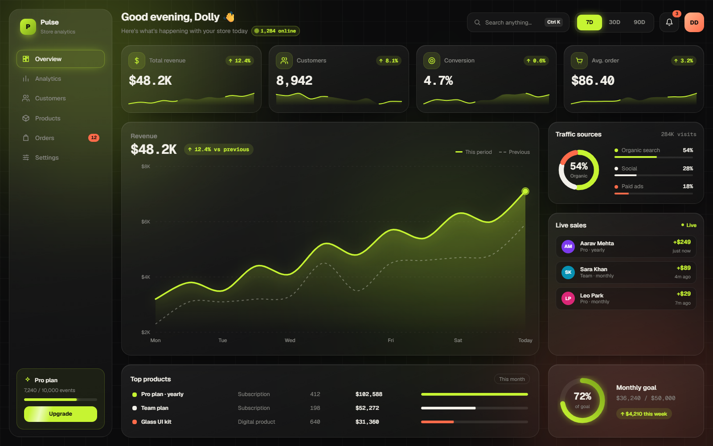

# Pulse Analytics Dashboard

An animated desktop analytics dashboard: KPI cards with a cursor spotlight, a revenue chart you can scrub, a live sales feed and a **⌘K / Ctrl+K command palette**.
Built with **Next.js 16 · TypeScript · Tailwind CSS v4 · Motion**.

**Live demo → [codewithdolly.vercel.app/analytics](https://codewithdolly.vercel.app/analytics/)**



## Features

- **Global date range (7D / 30D / 90D):** every KPI counts up to its new value and the revenue chart morphs into the new shape.
- **Revenue chart:** smooth SVG path, a dashed previous-period line, and a scrub cursor with a tooltip that follows the pointer.
- **KPI cards:** a radial spotlight and a glowing border that follow the cursor, plus a sparkline in each card.
- **Live sales:** new orders slide into the feed with a toast, and the revenue numbers update with them.
- **Command palette (⌘K / Ctrl+K):** type to search by name or keyword, grouped results, ↑ ↓ to move, Enter to run, Esc to close. Includes switching the range, exporting CSV, pausing the live feed and copying the link.
- **Also included:** a donut chart where hovering a source focuses its slice, top products, a monthly goal ring and an animated sidebar.
- **Accessibility:** keyboard-friendly palette, labelled controls, and `prefers-reduced-motion` respected through `MotionConfig`.

## Quick start

```bash
npm install
npm run dev      # http://localhost:3000
npm run build    # static export in ./out (deploy anywhere)
```

## Usage

```tsx
import { AnalyticsDashboard } from "@/components/analytics";

<AnalyticsDashboard
  name="Alex"          // greeting in the top bar
  liveAfter={4000}     // first demo sale after 4s (0 turns the feed off)
  liveEvery={7000}     // then one every 7s
/>
```

All numbers come from `src/components/analytics/data.ts` (`RANGES`, `SOURCES`, `INITIAL_SALES`, `PRODUCTS`, `GOAL`). Replace them with data from your API, Supabase, Stripe or any database.

The command palette works on its own too:

```tsx
import { CommandPalette, type Command } from "@/components/analytics";

const commands: Command[] = [
  { id: "new", group: "Actions", icon: "bolt", label: "Create invoice", keywords: "bill", run: () => router.push("/invoices/new") },
];

<CommandPalette open={open} onClose={() => setOpen(false)} commands={commands} />
```

## Structure

```
src/
  app/                    layout · page (demo) · globals.css (theme + animations)
  components/analytics/   analytics-dashboard · sidebar · topbar · kpi-card · revenue-chart
                          traffic-card · live-sales · bottom-row · command-palette · panel
                          icons · chart-utils · data
  hooks/                  use-count-up · use-size
```

## Theme

The colors are tokens in `src/app/globals.css` (`@theme`). Change them there.

Graphite `#0B0B0C` · Electric Lime `#C6F432` · Bone `#F2F0E9` · Smoke `#8A8A85` · Coral `#FF6B4A` · Font: Geist

## License

MIT. Free for personal and commercial projects.

---

Made by **Dolly Diwakar** · more production-grade UI on Instagram **[@codewithdolly_](https://instagram.com/codewithdolly_)**. A ⭐ helps a lot.
